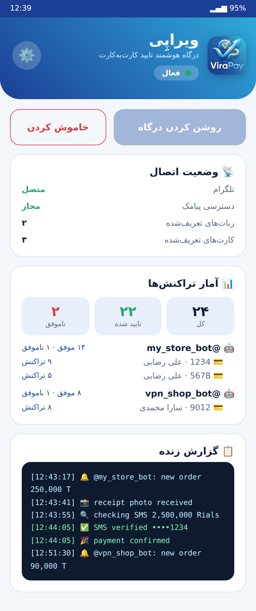
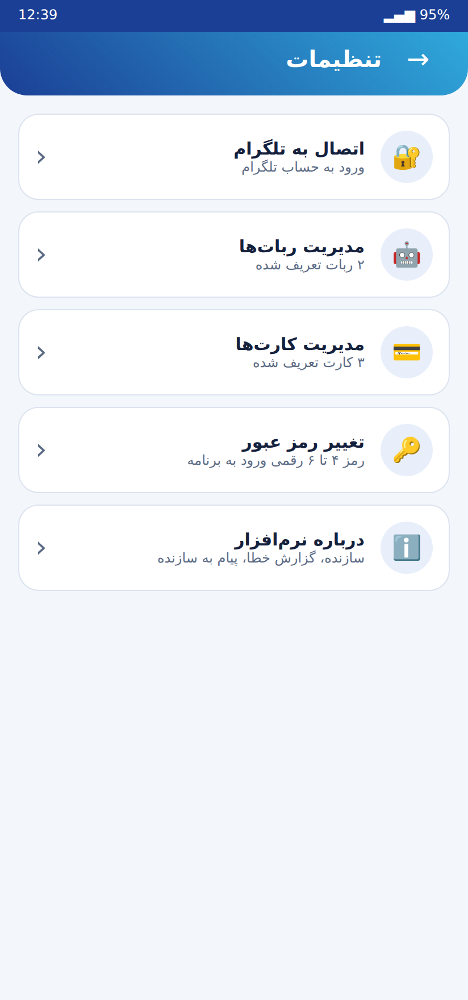
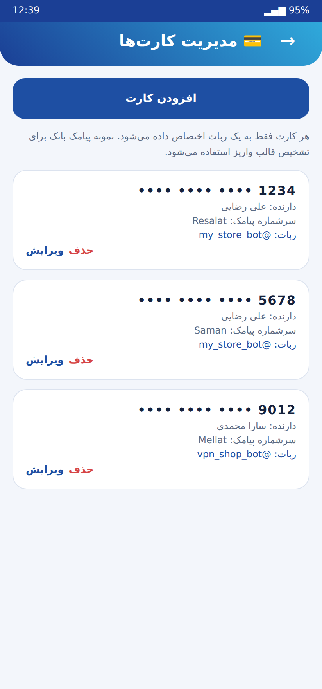

# ViraPay / ویراپِی

**فارسی** — ویراپِی یک درگاه پرداخت خودکار اندرویدی است که پرداخت‌های کارت‌به‌کارت ربات‌های فروشگاهی تلگرام را با تطبیق پیامک بانک تایید می‌کند.
**English** — ViraPay is an Android gateway that auto-confirms card-to-card payments of Telegram store bots by matching the bank SMS.

## امکانات / Features

- چند ربات و چند کارت؛ هر ربات چند کارت دارد، **هر کارت فقط به یک ربات** تعلق دارد (شماره کارت تکراری پذیرفته نمی‌شود)
- تنظیمات: تغییر رمز (۴ تا ۶ رقم)، اطلاعات کارت (شماره، نام دارنده، نمونه پیامک، سرشماره)، اطلاعات ربات (آیدی، نام کاربری، ادمین)، درباره (سازنده، گزارش خطا، پیام به سازنده)
- آمار: لاگ زنده، وضعیت اتصال، تعداد تراکنش هر ربات و هر کارت
- قالب پیامک هر بانک از روی «نمونه پیامک» یاد گرفته می‌شود؛ برداشت‌ها و مبلغ‌های مشابه (مثلاً `+5,000` در برابر `+5,000,000`) هرگز تایید نمی‌شوند
- فونت وزیرمتن، حالت شب، راست‌به‌چپ
- لایسنس وابسته به دستگاه (ساخته شده، **غیرفعال**؛ پایین‌تر)

## ساخت APK / Build

1. Push به `main` یا **Actions → Build APK → Run workflow**
2. فایل `ViraPay-apk` را دانلود و نصب کنید.
3. فونت وزیرمتن هنگام بیلد خودکار دانلود می‌شود (در صورت نبود اینترنت، فونت سیستم استفاده می‌شود).
4. تست‌های موتور پیامک: `python3 -m unittest discover -s tests -v`

### APK امضاشده (پیشنهادی)
در Settings → Secrets مخزن این‌ها را بسازید: `KEYSTORE_BASE64`, `KEYSTORE_PASSWORD`, `KEY_ALIAS`, `KEY_PASSWORD`. آنگاه Actions نسخهٔ **release امضاشده** می‌سازد.

## راه‌اندازی / First run
رمز تعیین کنید ← تنظیمات ← اتصال تلگرام (API ID/Hash، شماره، کد) ← افزودن ربات ← افزودن کارت (نمونه پیامک واریز را عیناً کپی کنید) ← روشن کردن درگاه.

## لایسنس / Licensing (ready, OFF)
- در `AppConfig.kt` مقدار `LICENSE_ENABLED = false` است؛ تا وقتی false است محدودیتی اعمال نمی‌شود و صفحهٔ لایسنس نمایش داده نمی‌شود.
- پس از فعال‌سازی: نسخهٔ رایگان = ۱ ربات + ۱ کارت. با ثبت لایسنس، برنامه **فقط روی همان دستگاه** نامحدود می‌شود.
- الگوریتم: برنامه `SHA-256(ANDROID_ID|package)` و یک nonce تصادفی را با کد لایسنس به سرور می‌فرستد. سرور در اولین فعال‌سازی کد را به آن دستگاه می‌بندد و توکن امضاشده (ECDSA P-256) برمی‌گرداند؛ دستگاه دیگر با همان کد پاسخ `already_used` می‌گیرد. برنامه امضا، شناسهٔ دستگاه و nonce را بررسی می‌کند (ضد جعل و ضد replay) و بعد از آن آفلاین کار می‌کند.
- سرور نمونه + تست: پوشهٔ [`license-server/`](license-server/) (`python3 -m unittest test_server -v`).
- مراحل فعال‌سازی: `python3 gen_keys.py` ← کلید عمومی در `LICENSE_PUBLIC_KEY` ← آدرس سرور در `LICENSE_SERVER_URL` ← `LICENSE_ENABLED = true`.
- اگر کاربر گوشی را فکتوری ریست کند، شناسهٔ دستگاه عوض می‌شود؛ با `POST /admin/reset` کد را آزاد کنید.

## امنیت / Security notes
- حداقل دسترسی‌ها: اینترنت، خواندن پیامک (برای تایید پرداخت)، سرویس پیش‌زمینه و اعلان. بدون `RECEIVE_SMS`، بدون ترافیک غیررمزشده، `allowBackup=false`.
- دسترسی `READ_SMS` در گوگل‌پلی «محدودشده» است؛ این برنامه برای نصب مستقیم APK مناسب است، نه انتشار در پلی‌استور. گوگل پلی‌پروتکت ممکن است برای هر APK ناشناخته (به‌خصوص امضانشده) هشدار «برنامه ناشناس» نشان دهد؛ با امضای release این احتمال کم می‌شود.
- فایل نشست تلگرام (`virapay_session.session`) دسترسی کامل به اکانت می‌دهد؛ از یک اکانت اختصاصی استفاده کنید.
- شماره کارت واقعی یا توکن را در مخزن commit نکنید.

## پیش‌نمایش / Preview
> تصاویر طراحی رابط هستند (شبیه‌سازی)، نه اسکرین‌شات واقعی گوشی. / Design mock-ups, not device screenshots.

| داشبورد | تنظیمات | کارت‌ها |
|---|---|---|
|  |  |  |
